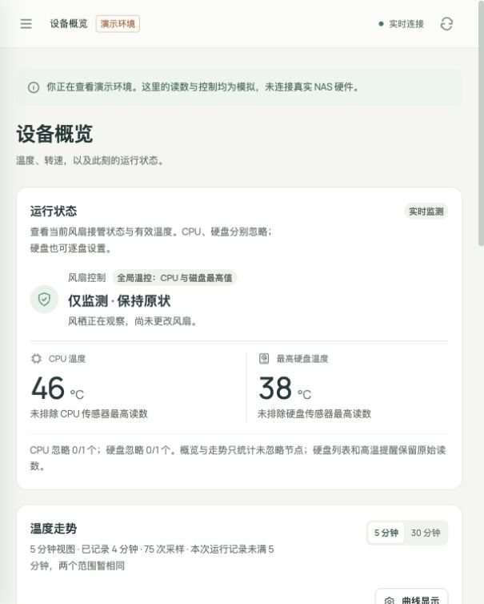
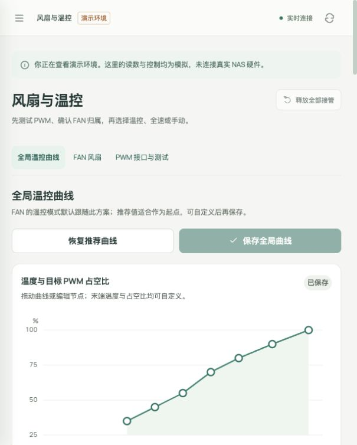
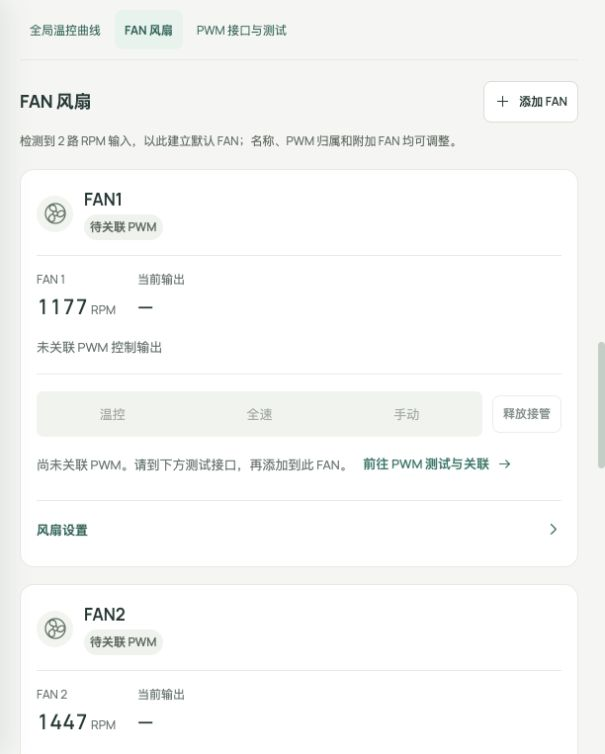
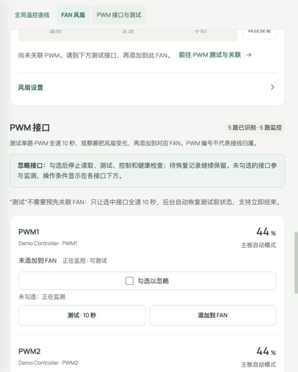

# 风栖 / Fan Control Studio

为飞牛 fnOS 设计的本地风扇与温度管理应用。当前源码版本 **1.4.0**，可构建 x86 fnOS FPK。项目主体使用 MIT 许可证。

功能包括 CPU 与硬盘温度监控、5/30 分钟温度走势、可编辑的全局或独立温控曲线、实体 FAN 分组、逐路 PWM 测试以及手动/全速/温控模式。首次安装可创建访问密码，登录后可修改并撤销旧会话。单传感器曲线使用独立颜色的虚线，CPU 与硬盘平均线分别使用红、蓝实线。

| 文档 | 内容 |
| --- | --- |
| [使用说明](docs/USAGE.md) | 安装、识别 PWM/FAN、调速模式、温控曲线、异常处理 |
| [构建说明](docs/BUILD.md) | 环境准备、构建 FPK、代理和驱动边界 |
| [API 说明](src/app/bin/API.md) | 后端接口和控制行为 |
| [更新记录](CHANGELOG.md) | 版本变更 |
| [许可](LICENSE) | MIT |

## 快速开始

1. 在飞牛应用中心安装 **Python 3.12（python312）**。
2. 从 [GitHub Releases](https://github.com/nbiwx/fan-control-studio/releases) 下载通用 `.fpk`，或克隆仓库并按[构建说明](docs/BUILD.md)自行生成。
3. 在应用中心选择“手动安装”，安装生成的 FPK；向导中设置独立访问密码（10–128 个字符）。
4. 从飞牛桌面打开“风栖”并登录。默认服务端口为 **18791**。

## 界面预览

以下截图使用应用演示模式和虚构的传感器读数生成，不包含真实 NAS 的硬件信息。

<table>
  <tr><th>首次设置访问密码</th><th>设备概览</th></tr>
  <tr><td></td><td></td></tr>
  <tr><th>全局温控曲线</th><th>实体 FAN 分组</th></tr>
  <tr><td></td><td></td></tr>
  <tr><th>PWM 接口测试</th><th>修改访问密码</th></tr>
  <tr><td></td><td></td></tr>
</table>

## 硬件与安全

应用通过 Linux `hwmon` 读取温度、RPM 并控制系统暴露的 PWM 接口。可控接口取决于主板、内核和驱动。公开源码不含为个人 NAS 编译的内核模块、主板标识或诊断截图；GitHub Releases 提供的安装包是通用构建，只使用目标系统已经暴露的接口。需要额外驱动时，请针对自己的主板和内核单独构建并审查，不要复用其它设备的内核模块。

飞牛包以 root 运行，以访问系统 PWM 接口。Web 界面要求独立密码，服务不应直接暴露到公网；请只在可信网络中使用。

新建 FAN 默认只监测。测试单路 PWM 会临时请求全速，持续 10 秒后自动恢复；确认它实际影响的风扇后，再把它加入 FAN。未确认接线前不要批量控制未知输出。访问密码请勿复用其它服务的密码。详细步骤见[使用说明](docs/USAGE.md)。

应用不使用 Docker、CDN 或运行时外网服务。首次构建需要获取并校验固定版本的飞牛官方 `fnpack` 工具；安装后的应用不依赖该工具。
